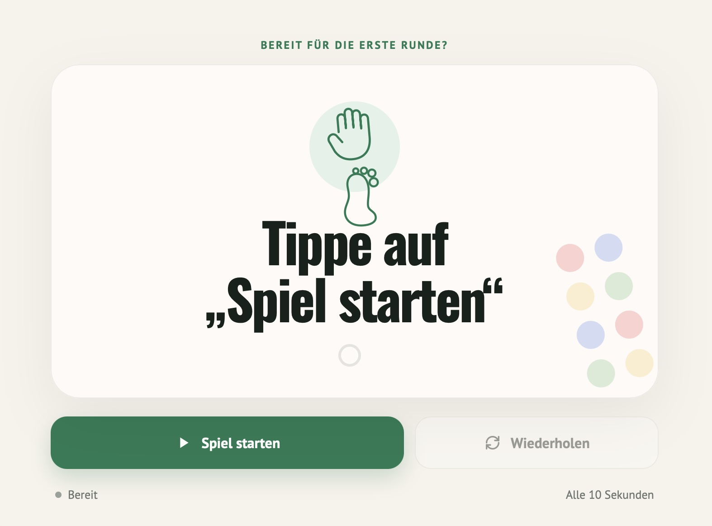
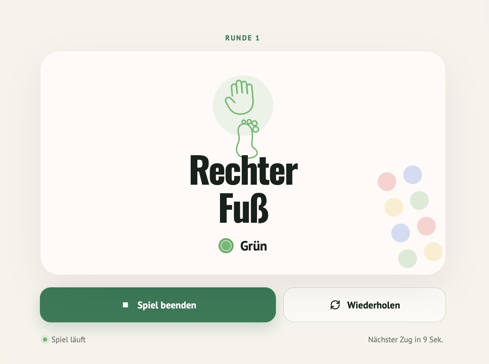

# Verdreht – Twister-Drehscheibe online mit automatischer Ansage

Eine Twister-Drehscheibe als Web-App, die **von allein läuft**: Sie lost im eingestellten Takt den
nächsten Zug aus und sagt ihn auf Deutsch an, zum Beispiel „Linke Hand auf Rot“. Niemand muss
zwischendurch einen Button drücken. Kein Build, kein Framework, kein Backend und kein Tracking.

Live ausprobieren: [mizine.de/verdreht](https://mizine.de/verdreht/)

> Unabhängiges Fanprojekt. Nicht verbunden mit Hasbro; „Twister“ ist eine Marke von Hasbro.

## Warum?

Bei Twister braucht es eigentlich eine dritte Person, die an der Drehscheibe dreht und ansagt.
Viele Online-Drehscheiben lösen das nicht: Dort muss bei jedem Zug jemand auf „Drehen“
tippen, und wer mit Händen und Füßen auf der Matte steht, kommt nicht ans Handy.

Verdreht läuft deshalb ohne Bedienung: Handy oder Tablet neben die Matte legen, einmal „Spiel
starten“ tippen, und ab dann kommt alle paar Sekunden automatisch die nächste Ansage. So könnt Ihr
**zu zweit spielen, ohne Spielleiter**, und alle Anwesenden sind auf der Matte statt daneben.

| Start | Im Spiel |
| --- | --- |
|  |  |

## Spielablauf

- Alle 16 Kombinationen aus Körperteil und Farbe werden gemischt ausgespielt.
- Eine Kombination wiederholt sich erst, wenn der Stapel leer ist.
- Das Intervall ist zwischen 5 und 60 Sekunden einstellbar.
- Fünf Sekunden vor dem nächsten Zug kann eine Erinnerung angesagt werden.
- Die Ansagen kommen aus mitgelieferten Sprachaufnahmen oder aus der deutschen Browser-Stimme.
- Nach dem ersten Laden funktioniert die App dank Service Worker auch offline und lässt sich als App installieren.

## Lokal starten

Direktes Öffnen von `index.html` funktioniert für die Browser-Stimme. Damit auch
die WAV-Dateien und der Offline-Modus funktionieren, starte einen kleinen Server:

```bash
python3 -m http.server 8080
```

Danach `http://localhost:8080` öffnen.

## Hosting

Den gesamten Ordner zu GitHub Pages, Netlify, Vercel oder auf einen gewöhnlichen Webspace
hochladen. Es ist keine besondere Konfiguration nötig.

Die App enthält bewusst kein Impressum und keine Datenschutzerklärung. Wenn Du sie öffentlich
hostest, ergänze die Links, die für Deine Seite vorgeschrieben sind.

## Datenschutz

Die App setzt keine Cookies, enthält kein Tracking und lädt keine externen Ressourcen. Einstellungen
werden nur lokal im Browser (`localStorage`) gespeichert.

Wird die Browser-Stimme verwendet, hängt es vom Browser ab, ob die Sprachausgabe lokal oder über
einen Cloud-Dienst des Browserherstellers erzeugt wird. Mit den mitgelieferten WAV-Dateien bleibt
alles lokal.

## Eigene Stimme

Die benötigten Dateien und Dateinamen stehen in [`audio/README.md`](audio/README.md).
Du kannst sie selbst aufnehmen oder einmalig mit einem Sprachdienst wie ElevenLabs erzeugen.
Statische Audiodateien sind für eine öffentlich gehostete App sicherer als ein API-Key im Browser.

## Lizenz

- **Code:** MIT, siehe [LICENSE](LICENSE).
- **Schriften:** Oswald und PT Sans stehen unter der SIL Open Font License 1.1, siehe
  [`fonts/OFL-Oswald.txt`](fonts/OFL-Oswald.txt) und [`fonts/OFL-PT-Sans.txt`](fonts/OFL-PT-Sans.txt).
- **Sprachaufnahmen (`audio/*.wav`):** © Viktor Dite. Die Stimme ist meine eigene, erzeugt mit
  ElevenLabs. Die Aufnahmen dürfen als Teil dieser App und von Forks dieser App genutzt und
  weitergegeben werden. Jede andere Verwendung der Aufnahmen oder der Stimme ist nicht gestattet.
